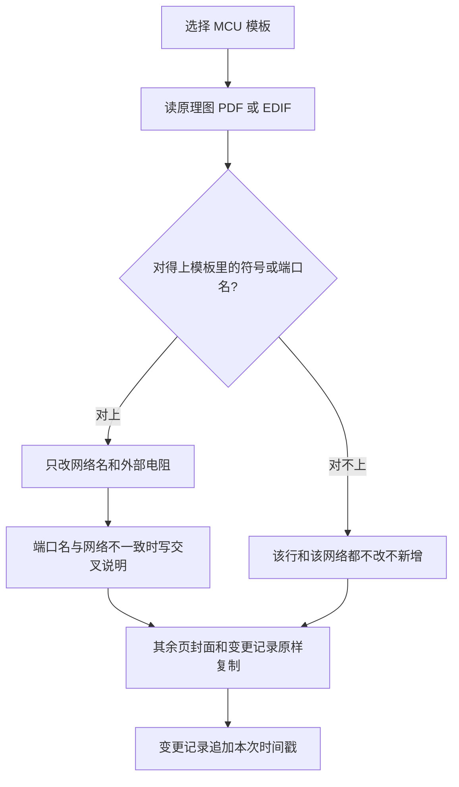
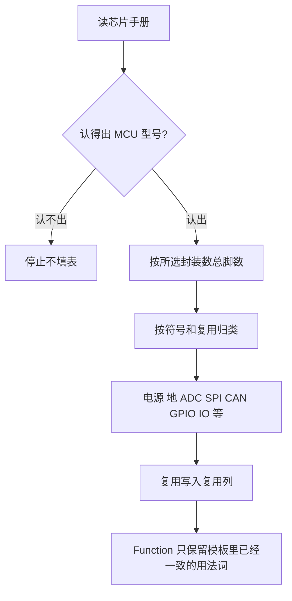
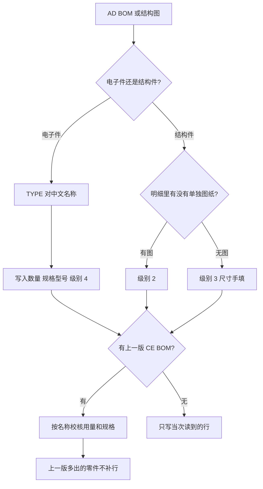
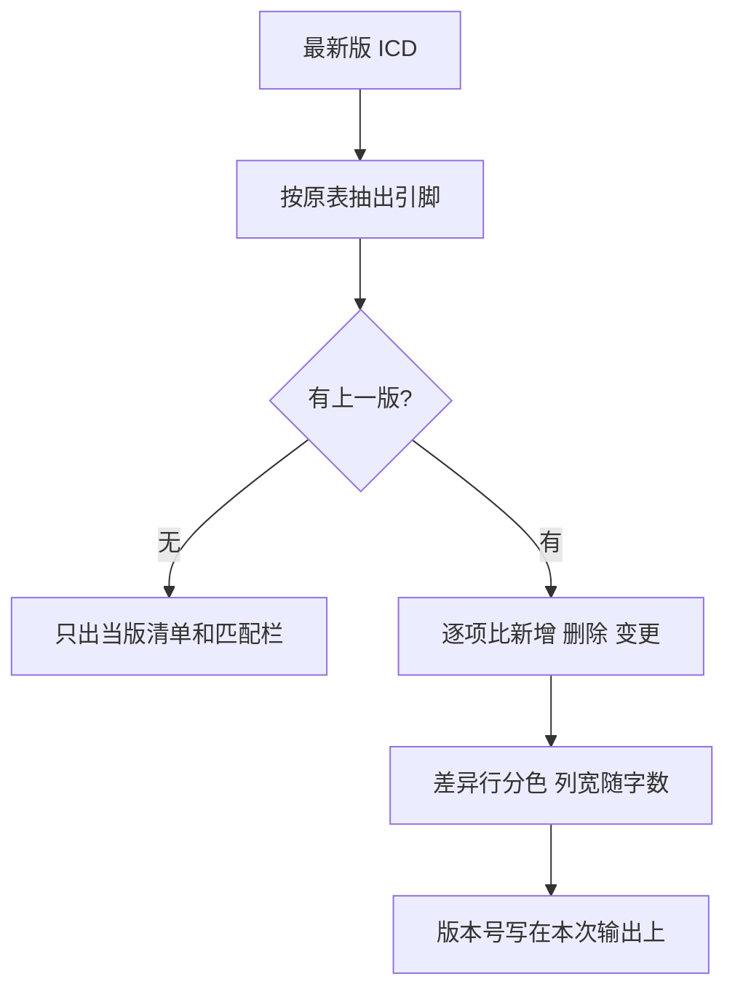

# 出表流程

每一步只使用当次输入里写明的内容。对不上的格子留空或标成待复核，不靠模型补数。

## 有原理图的 HSI

输入：所选 HSI 模板，原理图 PDF 或 EDIF。可选上一版只作记录，不覆盖模板正文。

输出：同一套表。改过的格子标待人工复核。

边界：串联电阻不写成上拉或下拉。原理图没有的脚不删除。模板里没有的网络不新开一行。

## 无原理图的 HSI

输入：手册 PDF、MCU 型号、封装、HSI 模板。

输出：端口表、手册依据里的分类汇总、封面脚数。模型只做已填行的矛盾检查，不决定类别和名称。

边界：手册没写的方向、复用、名称留空。分类写在标记说明，不写进 Function。

## CE BOM

输入：AD 导出的 Excel，或总成图纸。表格式用确认过的 CE BOM。上一版可选。

输出：供应商表。电子件和结构件同时有时，结构另起一张同样的列。

边界：TYPE 不在对照表里的中文名称留空。图纸没有单列外形尺寸时不写长宽高。净重没有单位时不写。

## ICD

输入：当版 ICD，可选上一版。

输出：原格式清单，另加匹配和版本。有上一版时增加差异表。

边界：当版没有的信号不补。颜色只标差异种类，不改原表其他单元格的格式。
