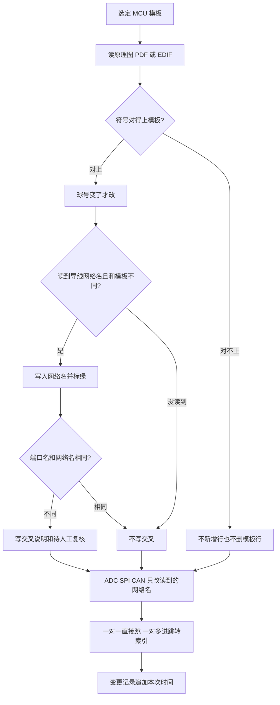
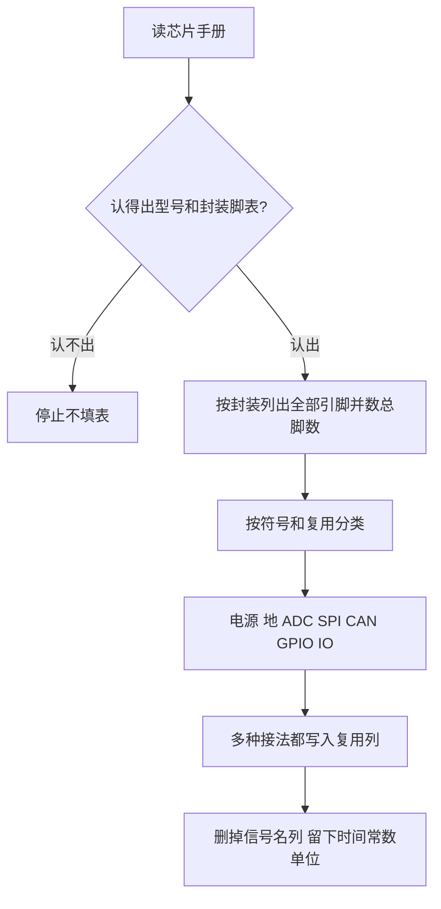
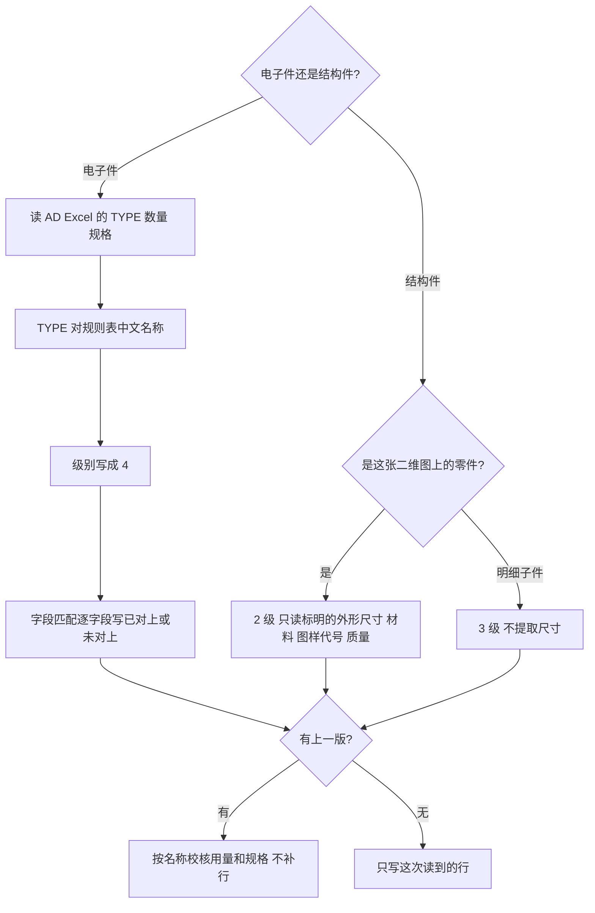
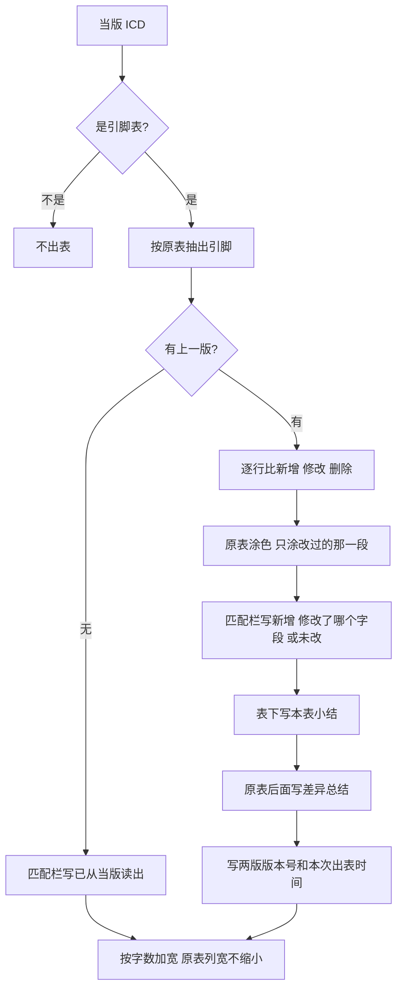

# 出表流程

每一步只使用当次输入里写明的内容。对不上的格子留空或标成待复核，不靠模型补数。

## 有原理图的 HSI

输入：所选 HSI 模板，原理图 PDF 或 EDIF。

输出：同一套表。改过的格子标绿，并写待人工复核。封面和没改的页保持模板。

边界：脚号别名不是网络名。空的复用可以填上功能名，只把这一格标绿，不把整行写成待人工复核。串联电阻不写成上拉或下拉。模板里没有的脚不新增。原理图没有的脚不删除。读不到导线名的格子保持模板原文。`7_Dead Time` 的 μs 写成可改的格子，要求文字和时序图跟着这一格变。

## 无原理图的 HSI

输入：手册 PDF、MCU 型号、封装、HSI 模板。

输出：端口表、手册依据里的分类汇总、封面脚数。模型只做已填行的矛盾检查，不决定类别和名称。

边界：手册没写的方向、复用、名称留空。分类写在标记说明，不写进 Function。没有原理图就不留信号名。

## CE BOM

输入：电子件用 AD 导出的 Excel。结构件用二维图。表格式用确认过的 CE BOM。上一版可选。

输出：供应商表。电子件和结构件同时有时，结构另起一张同样的列。另有字段匹配页。

边界：TYPE 不在规则表里的中文名称留空。3 级件不提取尺寸。图纸没有单列外形尺寸时不写长宽高。净重没有单位时不写。不把一次出表判成已经达到 100%。

## ICD

输入：当版 ICD，可选上一版。

输出：原表保持版式，右侧加匹配栏。有上一版时，表下有本表小结，原表后面有差异总结。

边界：当版没有的信号不补。删除的行不插回当版，写在小结里。颜色只标差异种类。变更记录不进入输出。
